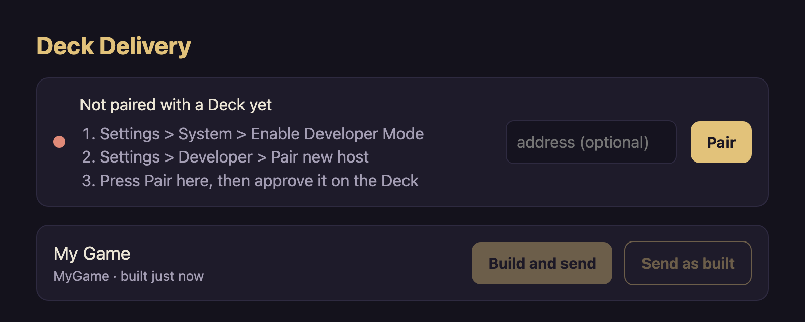

# Deck Delivery: macOS to Steam Deck

Send a game build from your Mac to your Steam Deck in one command, straight into the Deck's library. No Desktop Mode, no USB stick, no download page.

```bash
deck-delivery send MyGame
# Building MyGame: bash tools/build_linux.sh
# Sending MyGame (412 MB on disk; only what changed is sent).
# Done in 9s. On the Deck: Library > Non-Steam > Devkit Game: MyGame
```

Deck Delivery is made for macOS and made to be driven by a coding agent. Tell Claude Code, Codex or Cursor "put this on my Deck" and it builds the game, sends it and tells you where to find it. It ships with a skill so the agent knows how, and a prompt you can paste to have the agent set everything up.

It is one Python file that uses only what macOS already has: `python3`, `ssh`, `ssh-keygen`, `rsync` and Bonjour. Nothing to install with pip, brew or uv.

## Set it up with your agent

Open your game's project in Claude Code, Codex or Cursor and paste this:

```text
Set up Deck Delivery (https://github.com/banjtheman/macos-to-steam-deck) so you can put builds of this project on my Steam Deck.

1. If the `deck-delivery` command is missing, clone the repo to ~/.deck-delivery and run `python3 ~/.deck-delivery/deck.py install`. Then read SKILL.md in that folder and follow it from here on.
2. Run `deck-delivery status`. If it is not paired, walk me through it: on the Deck, Settings > System > Enable Developer Mode, then Settings > Developer > Pair new host. Run `deck-delivery pair` once I say the Deck is showing that screen, and wait while I approve it there.
3. Give this project one command that makes a Linux x86-64 build in a folder of its own (for Godot, a Linux export preset and a build script; for Unity, a Linux Standalone build in batch mode). Check the build really produced its files.
4. Write deck_delivery.json in the project root, list it with `deck-delivery add`, and send it with `deck-delivery send <id>`.
5. Tell me where it is on the Deck.
```

After that, all you need to say is "send the latest build to my Deck". The same prompt is in [PROMPT.md](PROMPT.md) with a few shorter ones.

## Set it up by hand

### Install

```bash
git clone https://github.com/banjtheman/macos-to-steam-deck ~/.deck-delivery
python3 ~/.deck-delivery/deck.py install
```

`install` puts a `deck-delivery` command in `~/.local/bin` and copies [SKILL.md](SKILL.md) into `~/.claude/skills/`, `~/.codex/skills/` and `~/.cursor/skills/`, whichever exist. If `~/.local/bin` is not on your `PATH` it says so.

Needs: macOS with `python3` 3.9 or newer (the one from Xcode's command line tools is fine), and a Mac and a Deck on the same network.

### Pair your Deck (once)

On the Deck, in Gaming Mode:

1. Settings > System > Enable Developer Mode.
2. Settings > Developer > Pair new host.

Then on the Mac:

```bash
deck-delivery pair                # finds the Deck on the network
deck-delivery pair 192.168.1.42   # or give its address (Settings > Internet on the Deck)
```

Approve the request on the Deck's screen. If the router gives the Deck a new address later, Deck Delivery finds it again by itself.

### Give a project a game

Each project keeps a `deck_delivery.json` in its root:

```json
{
  "games": [
    {
      "id": "MyGame",
      "name": "My Game",
      "build": "bash tools/build_linux.sh",
      "folder": "build/linux",
      "run": "./MyGame.x86_64"
    }
  ]
}
```

List it once, then send:

```bash
deck-delivery add /absolute/path/to/deck_delivery.json
deck-delivery send MyGame
```

| Field | Meaning |
|---|---|
| `id` | The game's name in the Deck's library ("Devkit Game: MyGame"). Letters, digits, `_` and `.`, starting with a letter. Each game on your Mac needs its own. |
| `name` | What the page and `games` call it. Optional. |
| `folder` | The folder to send, inside `root`. It is mirrored: a file removed here is removed on the Deck. Keep it to the build alone. |
| `run` | The command that starts the game, run inside that folder. Arguments are allowed. |
| `build` | Optional. A command run in `root` before sending. If it fails, nothing is sent. |
| `root` | Optional. The project folder, relative to the json file. The default is the file's own folder. |
| `proton` | Optional. `true` for a Windows build, which Steam then runs through Proton. The Linux build is the tested path. |
| `settings` | Optional. Extra settings passed to Steam for the title. |

What the build has to be: something the Deck can run, which in practice means a Linux x86-64 build. The start file is made executable on the Deck for you.

### Examples

- [examples/godot](examples/godot): a Godot 4 Linux export, with a build script that checks the export really made its files (Godot can report success and make nothing).
- [examples/unity](examples/unity): a Unity Linux Standalone build in batch mode.
- [examples/prebuilt](examples/prebuilt): any folder you already have, sent as it is.

## The page

```bash
deck-delivery ui
```



A page at http://localhost:8790 with every listed game, a Build and send button, a Send as built button, the Deck's state and the live output of a send. It only answers this Mac (see Security).

## Commands

| Command | What it does |
|---|---|
| `deck-delivery send <id> [--no-build]` | Build, send, add to the Deck's library. |
| `deck-delivery games` | Every game this Mac can send, and the file that lists it. |
| `deck-delivery add <file>` / `forget <file>` | List or stop listing a project's `deck_delivery.json`. |
| `deck-delivery status` | Whether the Deck answers, and what is on it. |
| `deck-delivery pair [address]` | Pair with a Deck. |
| `deck-delivery ui [--port N]` | The page. |
| `deck-delivery guide` | Print this file. |
| `deck-delivery install` / `uninstall` | Put the command and the skill in place, or take them away. |
| `deck-delivery --version` | The version. |

## When it goes wrong

| It says | What it means |
|---|---|
| Not paired with a Deck yet | Do "Pair your Deck" above. |
| No Deck answered | The Deck is asleep, off this network, or Developer Mode is off. Give its address: `deck-delivery pair <address>`. |
| The Deck turned the pairing down | "Pair new host" was not showing on the Deck, or the request was declined. |
| Cannot reach the Deck | It is asleep or off the network. Wake it and send again. |
| The build failed; nothing was sent | The game's `build` command returned an error. Its output is above the message. |
| Nothing to send | `folder` is missing or empty. Build first, or fix `folder`. |
| X is not in the folder | `run` names a file the build did not make. |
| The transfer failed | The network dropped mid-send. Send again; it picks up where it left off. |
| Steam is not running on the Deck | The files are in place but the library was not updated. Send again once Steam is up. |
| Steam did not answer | Developer Mode was probably switched off. Turn it back on and send again. |
| Two games are called X | Ids are names on the Deck. Change one of them. |

To take a game off the Deck, remove it from the library there (the game's page > gear > Manage). Its files stay in `~/devkit-game/<id>/` on the Deck until deleted.

## How it works

A Steam Deck in Developer Mode runs Valve's devkit service. It pairs with a development machine, takes files over ssh, and asks the running Steam client to add the game, which appears as "Devkit Game: <id>". Valve's own client for this runs on Windows and Linux. Deck Delivery is a Mac client for the same protocol:

1. **Pairing** posts this Mac's public key to the devkit service on the Deck's port 32000, and you approve it on the Deck. The Deck is found with Bonjour (`_steamos-devkit._tcp`).
2. **A send** runs the game's build command, mirrors the build folder to `~/devkit-game/<id>/` on the Deck with rsync (only what changed crosses the network, so a second send takes seconds), then writes how the game starts where Steam looks for it and asks Steam to add it through its devkit pipe. Steam answers within a few seconds and the send reports what it said.

The protocol was read from Valve's open-source client, [steamos-devkit](https://gitlab.steamos.cloud/devkit/steamos-devkit) (MIT; see [NOTICE.md](NOTICE.md)).

## Security

- Pairing puts an ssh key for this Mac on the Deck. That is full control of the Deck from this Mac, the same as with Valve's tool. The key and the Deck's address stay in `~/.config/deck-delivery/` and never leave your Mac.
- The page listens on 127.0.0.1 only, answers only requests addressed to `localhost`, and refuses to send or pair unless the request carries the page's own header, so another website open in your browser cannot drive it.
- A game's `build` command runs on your Mac as you. Only list `deck_delivery.json` files you trust.

## Uninstall

```bash
deck-delivery uninstall          # the command and the skill copies
rm -rf ~/.config/deck-delivery   # the pairing, on this Mac
rm -rf ~/.deck-delivery          # the tool itself
```

On another Mac, install again and pair again: pairings are per Mac.

## Development

```bash
python3 -m unittest discover -s tests
```

The tests need no Deck: they check the game files, the step that runs on the Deck against a pretend Steam, and the page's guard. `DECK_DELIVERY_HOME` moves the pairing and the list of projects to another folder.

## License

MIT. See [LICENSE](LICENSE), and [NOTICE.md](NOTICE.md) for Valve's.
